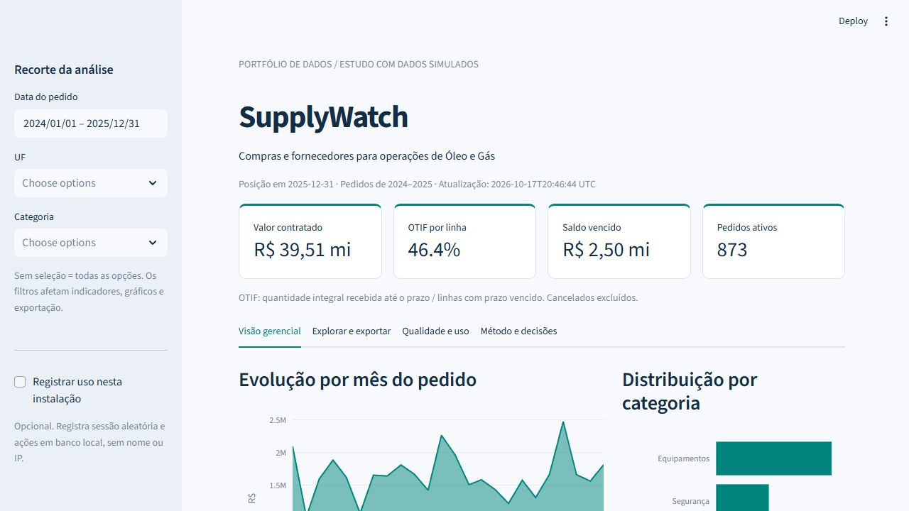
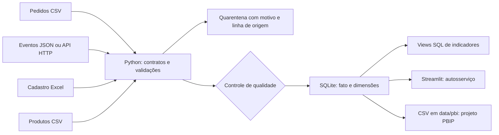

# SupplyWatch


**Quanto está contratado, quais fornecedores atrasam e qual saldo vencido merece ação primeiro?**

Projeto de portfólio de análise de dados com pipeline Python, SQL relacional, modelo estrela,
dashboard Streamlit e pacote de modelagem Power BI (TMDL, DAX e Power Query).
Ordens de compra, entregas parciais, fornecedores, materiais industriais e contexto de Óleo e Gás.

> Estudo com dados totalmente simulados, sem vínculo com uma empresa real. Resultados ilustram o método;
> não representam experiência profissional, economia realizada ou indicadores reais do setor.



## O que a análise encontrou

R$ 39,51 milhões contratados, OTIF de 46,4% e R$ 2,50 milhões de saldo vencido. São resultados reproduzíveis da amostra com semente 42, posição em 31/12/2025.
Leia o [parecer com recomendações](reports/sample/executive_summary.md) e os [totais de conferência](reports/sample/metrics.json).
O OTIF inclui linhas vencidas ainda não entregues; o saldo vencido não é tratado como perda realizada.

## Executar em cinco minutos

Pré-requisito: Python 3.12. Os dados de demonstração já estão no repositório.

```bash
git clone https://github.com/JVCSampaio/supplywatch-analytics.git
cd supplywatch-analytics
python -m venv .venv
# Windows PowerShell:
.venv/Scripts/Activate.ps1
# Linux/macOS: source .venv/bin/activate
python -m pip install -r requirements.txt
python -m analytics.pipeline
python -m streamlit run app.py
```

Abra `http://localhost:8501`. A interface permite filtrar período, UF e categoria,
explorar dimensões, exportar CSV, examinar qualidade e registrar uso local opcional.
Para rodar os dois projetos ao mesmo tempo, use `--server.port=8502` no segundo.
Se a política do PowerShell bloquear ativação, use `.venv/Scripts/python.exe` no lugar de `python`.

```bash
python -m pytest -q
python -m ruff check .
# Opcional: gerar novamente os CSV/JSON de demonstração, com a mesma semente.
python -m analytics.seed
```

Docker opcional: `docker build -t supplywatch-analytics .` e `docker run --rm -p 8501:8501 supplywatch-analytics`.
O Dockerfile é fornecido como alternativa; a validação registrada foi feita com Python local e GitHub Actions.

## Fontes e arquitetura



A fato tem uma linha por item de pedido. Eventos são agregados antes do join para impedir multiplicação
do valor financeiro. Valores monetários são inteiros em centavos. Relacionamentos têm chaves e restrições
SQL explícitas. A carga reconstrói um banco temporário, confere integridade e substitui o banco publicado.

Para demonstrar integração por API, em outro terminal execute `python -m analytics.demo_api`.
Depois rode `python -m analytics.pipeline --api-base-url http://127.0.0.1:8765`.
É uma API local de demonstração com paginação; não se apresenta como um ERP real conectado.

## Power BI

O arquivo [SupplyWatch.pbip](SupplyWatch.pbip) é um projeto Power BI com modelo estrela e relatório de quatro páginas. Abra esse arquivo no Power BI Desktop no Windows. O roteiro, o diagrama, as medidas e o checklist estão em [powerbi/README.md](powerbi/README.md).

Não há arquivo `.pbix` neste repositório. As imagens em `docs/powerbi/` são pré-visualizações geradas por script com matplotlib, e não capturas do Power BI Desktop. O modelo passou no parser TMDL (`Microsoft.AnalysisServices`) e o relatório passou nos esquemas públicos do PBIR, mas o projeto ainda não foi aberto no Power BI Desktop.

O dashboard executável do projeto continua sendo **Streamlit + Plotly**. Não é alegada experiência com Tableau, Qlik ou outra ferramenta que este projeto não utilize.

## Como avaliar este projeto

| Evidência | Onde conferir |
| --- | --- |
| Requisitos e critérios de aceite | [Caso de negócio](docs/business_case.md) |
| Métricas e modelagem | [Dicionário](docs/data_dictionary.md), [schema SQL](sql/schema.sql) |
| ETL e qualidade | [Pipeline](analytics/pipeline.py), [regras](analytics/domain.py), [auditoria de exemplo](reports/sample/quality.json) |
| SQL analítico | [Marts com CTE e funções de janela](sql/marts.sql), [consultas](sql/analysis.sql) |
| Python e testes | [Testes](tests), [CI](.github/workflows/quality.yml) |
| BI e autosserviço | [App](app.py), [Power BI](powerbi/README.md), [SupplyWatch.pbip](SupplyWatch.pbip) |
| Recomendações e comunicação | [Parecer gerado a partir dos dados](reports/sample/executive_summary.md) |
| Adoção e manutenção | [Manual do usuário e operação](docs/runbook.md) |
| Inglês técnico | [English overview](docs/README.en.md) |

## Limites e próximos passos

- Snapshot de 2024-2025 com corte fixo. Não é um pipeline incremental nem um ambiente de produção.
- Sem impostos, câmbio, integração autenticada com ERP, SLA real, RLS ou armazenamento de dados pessoais.
- O banco SQLite e a telemetria local atendem demonstrações com baixo volume. Não há controle de acesso multiusuário.
- A publicação do SQLite é atômica; CSVs e relatórios derivados são regravados na sequência. Execute uma carga por vez e atualize o BI após seu término.
- Campos extraídos de produção exigiriam acordos de acesso, histórico de alterações e homologação dos donos dos indicadores.
- Plano sugerido: abrir o `.pbip` no Power BI Desktop, salvar um `.pbix` e só então conectar uma fonte autorizada.

MIT. Autor: [JVCSampaio](https://github.com/JVCSampaio).
