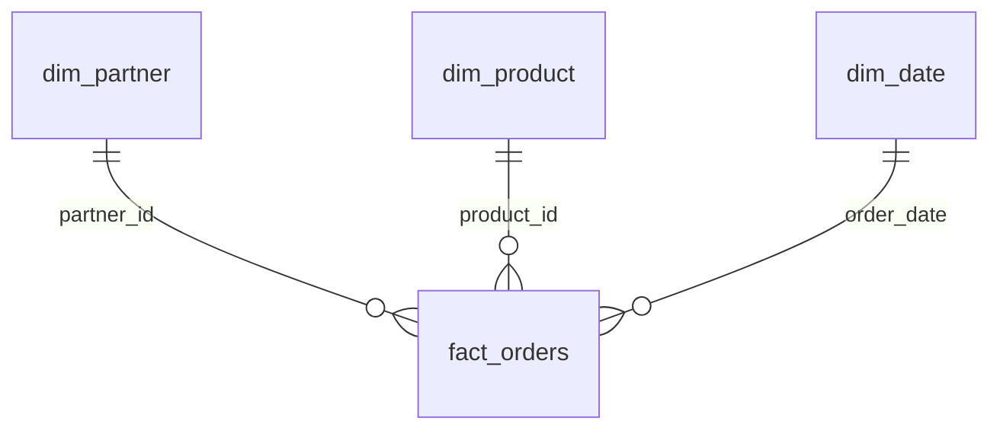

# Contratos, modelo e indicadores

## Fontes

| Arquivo | Grão | Contrato |
| --- | --- | --- |
| orders.csv | Uma linha de pedido | `line_id` único; `order_id` agrupa itens; IDs textuais, datas ISO, moeda BRL em centavos |
| products.csv | Um produto | `product_id` único, nome e categoria obrigatórios |
| partners.xlsx | Um fornecedor | Aba Partners, cabeçalho na linha 3; `partner_id`, nome, UF, segmento |
| events.json / GET /events | Um evento de recebimento | `event_id` único, linha existente, data ISO, quantidade inteira positiva |

O Excel foi criado como fonte tabular legível e é incluído no repositório. O gerador `analytics.seed`
reproduz apenas os CSVs e JSONs e preserva esse cadastro. Dados sintéticos sob a mesma licença do código.
Amostra: 1.800 linhas válidas de compra, 12 fornecedores, 8 produtos e 24 meses.
Cada pedido tem dois itens no gerador. IDs e nomes são fictícios, sem CNPJ, CPF ou contatos pessoais.

## Modelo estrela

`fact_orders.line_id` é a chave primária. `dim_date` contém cada dia de 01/01/2024 a 31/12/2025.
O período do painel é sempre a data do pedido; posição dos eventos até 31/12/2025.
As colunas finais e tipos estão em [schema.sql](../sql/schema.sql) e [schema Power BI](../powerbi/schema.json).
Tipos monetários: INTEGER, unidade centavo. Datas no SQLite: texto ISO validado na entrada.
O Power Query converte datas para tipo date e dinheiro inteiro para Int64 antes das medidas.

## Métricas

| Indicador | Fórmula | Regra |
| --- | --- | --- |
| Valor contratado | Σ quantidade × preço unitário | Cancelados = 0; valor contratado, não pago |
| OTIF por linha | Σ linhas integrais até prazo / Σ linhas com prazo ≤ corte | Cancelados fora; não entregues vencidas contam; zero denominador = ausente |
| Saldo aberto | Σ (quantidade pedida − recebida) × preço | Cancelados = 0 |
| Saldo vencido | Saldo aberto onde prazo ≤ corte | Não é perda realizada |
| Lead time completo | Média dos dias da ordem ao último recebimento | Só linhas integralmente recebidas; há viés de sobrevivência |
| Participação fornecedor | Valor fornecedor / valor no universo selecionado | Percentual recalculado no contexto |

## Controles de qualidade

- Ausência de coluna obrigatória: interrompe a execução.
- Dimensões nulas, vazias ou duplicadas: interrompem a execução para evitar fan-out.
- Duplicidade na chave de fatos/eventos: rejeita **todas** as ocorrências, sem escolher vencedor arbitrário.
- Números não finitos, datas inexistentes, status desconhecido, quantidades fracionárias ou negativas: quarentena.
- Eventos antes do pedido, após o corte, em linhas canceladas ou acima da quantidade: quarentena.
- Um evento inválido contamina a confiabilidade da linha: o pedido afetado e seus eventos também saem da fato.
- Chave estrangeira desconhecida: quarentena. Integridade relacional é conferida antes de publicar.
- Mais de 3% de linhas de origem rejeitadas ou fato vazia: bloqueio. O limiar é hipotético, passado pela CLI.
- As sete linhas inválidas incluídas na amostra são seis pedidos (quatro erros e duas chaves iguais) e um evento órfão.

A taxa de rejeição divide registros rejeitados por linhas de pedidos + eventos; não inclui cadastros,
que têm validação bloqueante. `source_row` é posição de registro começando em 1 (não o número da linha física do JSON).
Hashes SHA-256 identificam fontes; a resposta HTTP recebida também recebe hash próprio.
O lote publicado mantém o manifesto dentro do SQLite. A interface distingue esse lote da última tentativa de carga.
