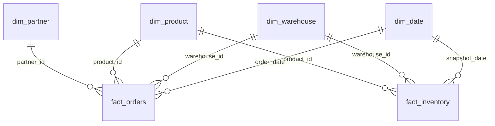
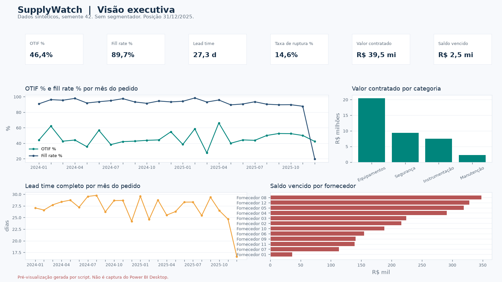
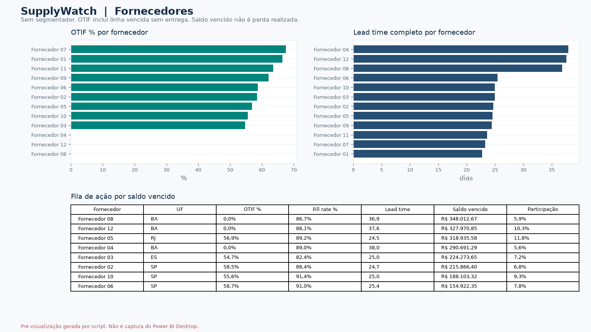
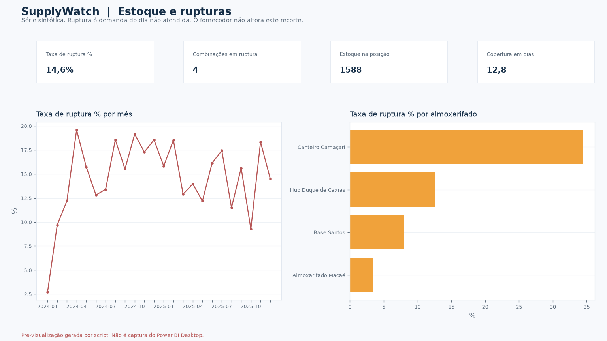
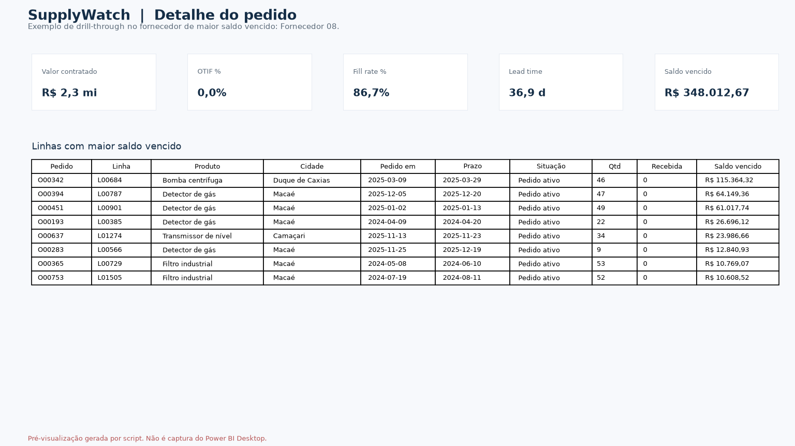

# Power BI: projeto PBIP

Este diretório explica o projeto que o Power BI Desktop abre. O arquivo está na raiz do repositório: [SupplyWatch.pbip](../SupplyWatch.pbip).

Não há `.pbix` aqui. As figuras em [docs/powerbi](../docs/powerbi) são pré-visualização gerada por script, não capturas do Power BI Desktop. O modelo TMDL foi lido pelo parser `Microsoft.AnalysisServices 19.118.3`. O JSON do relatório passou nos esquemas públicos do PBIR. O Desktop não foi executado neste ambiente, então a abertura visual no Windows ainda precisa ser conferida por uma pessoa.

Os dados são sintéticos, semente 42, posição 31/12/2025. Não representam uma operação real.

## Como abrir

1. Instale o Power BI Desktop atual no Windows, com suporte a projeto PBIP e ao formato de relatório PBIR (pasta `definition`, não o `report.json` único do PBIR-legacy).
2. Clone o repositório e abra `SupplyWatch.pbip` (Arquivo, Abrir, ou duplo clique). Não abra uma pasta solta.
3. Se o Desktop pedir permissão para a fonte Arquivo, autorize a pasta do repositório.
4. O parâmetro `DataFolder` vale `data/pbi`, caminho relativo à pasta do `.pbip`. As consultas leem `data/pbi/<arquivo>.csv`.
5. Sem segmentador, compare Valor contratado, OTIF %, Saldo vencido e Pedidos ativos com o [dicionário de medidas](../docs/dicionario_medidas.md) e com [metrics.json](../reports/sample/metrics.json). Tolerância: R$ 0,01 e 0,000001 na proporção.
6. Se a atualização disser que o arquivo não existe, o `File.Contents` dessa versão do Desktop não resolveu o caminho relativo. Rode `powershell -File powerbi/ajustar-caminho.ps1` ou edite o parâmetro `DataFolder` para o caminho absoluto de `data/pbi` com barras `/`. Exemplo: `C:/Users/John/supplywatch-analytics/data/pbi`. Não faça commit desse caminho.

O formato do relatório é PBIR (`SupplyWatch.Report/definition`). A `definition.pbir` está na versão 4.0 e aponta para `../SupplyWatch.SemanticModel`. Não há um `report.json` legado na raiz da pasta do relatório.

## Checklist do John

- [ ] Abrir `SupplyWatch.pbip` no Power BI Desktop no Windows.
- [ ] Atualizar os dados e conferir os quatro totais do dicionário, sem segmentador.
- [ ] Percorrer Visão executiva, Fornecedores e Estoque e rupturas.
- [ ] Clicar com o botão direito em um fornecedor e abrir o drill-through Detalhe do pedido. A página fica oculta no modo de exibição e aparece na edição.
- [ ] Tirar screenshots reais das quatro páginas. Substituir, na apresentação, as pré-visualizações geradas por script.
- [ ] Arquivo, Salvar como, Power BI (`*.pbix`).
- [ ] Não publicar no serviço nem apontar o modelo para um ERP sem autorização.

## Diagrama do modelo



`dim_date` é a tabela de datas (`dataCategory: Time` na coluna `Data`), de 01/01/2024 a 31/12/2025. Os relacionamentos são muitos-para-um, filtro da dimensão para a fato.

O segmentador de data filtra a data do pedido e a data da foto de estoque. Não recalcula `due_eligible`, `otif` nem `overdue_cents`: esses campos já nascem com o corte 31/12/2025.

O segmentador de fornecedor filtra pedidos. A ruptura não tem fornecedor.

## Páginas

Tela 16:9 (1280 por 720). Segmentadores sincronizados: Período (`dim_date[Data]`, entre), Fornecedor, Categoria e Almoxarifado.

| Página | O que responde |
| --- | --- |
| Visão executiva | OTIF %, fill rate %, lead time completo, taxa de ruptura %, valor contratado e saldo vencido, com tendência mensal, valor por categoria e saldo vencido por fornecedor. |
| Fornecedores | Quem entrega no prazo, quem demora e quem concentra saldo vencido. |
| Estoque e rupturas | Onde a demanda do dia ficou sem atendimento, e qual é o estoque na posição. |
| Detalhe do pedido | Linhas do fornecedor escolhido no drill-through. |

## Medidas

A fórmula, a pasta e o total sem segmentador estão no [dicionário de medidas](../docs/dicionario_medidas.md). A cópia de leitura do DAX está em [measures_pbip.dax](measures_pbip.dax). O que o Desktop carrega é o TMDL em `SupplyWatch.SemanticModel/definition/tables`.

Pedidos: Valor contratado, Saldo em aberto, Saldo vencido, Linhas elegíveis, Linhas OTIF, OTIF %, Lead time completo, Pedidos ativos, Participação fornecedor %, Quantidade pedida, Quantidade recebida, Fill rate %.

Estoque: Dias observados, Dias em ruptura, Taxa de ruptura %, Quantidade não atendida total, Estoque na posição, Demanda na posição, Combinações em ruptura, Cobertura em dias, Estoque de segurança na posição.

Calendário: Posição.

Regras curtas:

- OTIF é por linha. Linha vencida e ainda não entregue entra no denominador. Cancelados ficam de fora.
- Fill rate é quantidade recebida dividida pela quantidade pedida, só em linhas ativas. Não exige pontualidade. Na amostra sem filtro fica em 89,7%, enquanto o OTIF fica em 46,4%.
- Lead time completo é a média dos dias até o último recebimento, só em linha integral. Há viés de sobrevivência.
- Saldo vencido é exposição em aberto, não perda realizada.
- Ruptura é o dia em que a demanda do produto no almoxarifado não foi toda atendida. Dia sem demanda e com estoque zero não entra.
- Centavos viram reais uma vez, na medida. `DIVIDE` com denominador zero devolve branco.

Na amostra, o gerador de pedidos atrasa de propósito os fornecedores cujo número é múltiplo de 4. Por isso Fornecedor 04, 08 e 12 aparecem com OTIF 0% e fill rate ainda alto: a quantidade chega, fora do prazo. É comportamento da semente, não um achado de campo.

Em dezembro de 2025 o fill rate cai porque a posição é o próprio fim do mês e boa parte da quantidade ainda não foi recebida. O OTIF desse mês usa só as 26 linhas que já venceram.

## Dados

| Arquivo | Origem |
| --- | --- |
| `dim_partner.csv`, `dim_product.csv` | Pipeline, cadastros sintéticos. |
| `fact_orders.csv` | Pipeline, mais `warehouse_id` e `situacao`. |
| `dim_warehouse.csv`, `dim_date.csv`, `fact_inventory.csv` | `analytics/pbi_export.py`, semente 42. |

`warehouse_id` não existe em `data/source/orders.csv`. É um rótulo estável por `order_id`. Os dois itens do mesmo pedido ficam no mesmo almoxarifado. A foto de estoque não passa pelo controle de qualidade do pipeline.

Para gerar de novo:

```bash
python powerbi/build_pbip.py
```

O comando também redesenha as pré-visualizações. Ele precisa de `requirements.txt`, inclusive matplotlib.

## Pré-visualização gerada por script

Estas imagens repetem as regras das medidas em Python. Não são telas do Power BI.









Os cartões monetários da figura usam milhões com uma casa. O dicionário traz o valor em centavos de real.

## O que foi validado, e o que não foi

| Verificação | Resultado |
| --- | --- |
| Parser TMDL do modelo PBIP (6 tabelas, 7 relacionamentos, 22 medidas, `dim_date` como tabela de datas) | Passou. Evidência em [pbip_tmdl.json](../reports/sample/pbip_tmdl.json). |
| Esquemas JSON públicos do PBIR, do `.pbip` e do `.pbism` | Passou. Evidência em [pbip_structure.json](../reports/sample/pbip_structure.json). |
| Totais de pedidos sem filtro e com UF RJ | Iguais a `metrics.json` e `metrics_RJ.json`. |
| Execução do DAX no motor do Power BI | Não feita. |
| Execução do Power Query | Não feita. |
| Abertura e atualização no Power BI Desktop | Não feita. |

## Risco de o Desktop não abrir

O mais provável não é um projeto inválido, e sim a primeira atualização dos CSV.

- Não há `cache.abf`. Na primeira abertura o Desktop tenta ler os arquivos. Se o caminho relativo falhar, aparece erro de fonte de dados. O checklist acima diz como trocar `DataFolder`.
- A permissão da fonte Arquivo é um aviso normal, não um arquivo corrompido.
- Uma versão antiga do Desktop, sem PBIR em pasta, não abre este relatório. O formato legado de um único `report.json` não foi gerado.
- O tema base `CY24SU10` precisa existir nessa instalação. Um Desktop muito anterior pode reclamar do tema.
- Nada aqui configura gateway, RLS, atualização agendada ou publicação no serviço.

O pacote antigo `powerbi/model.tmdl` continua no repositório. Ele tem quatro tabelas, sem almoxarifado e sem relatório, e o validador ainda confere esse arquivo. Não é o projeto que se abre pelo `.pbip`.
